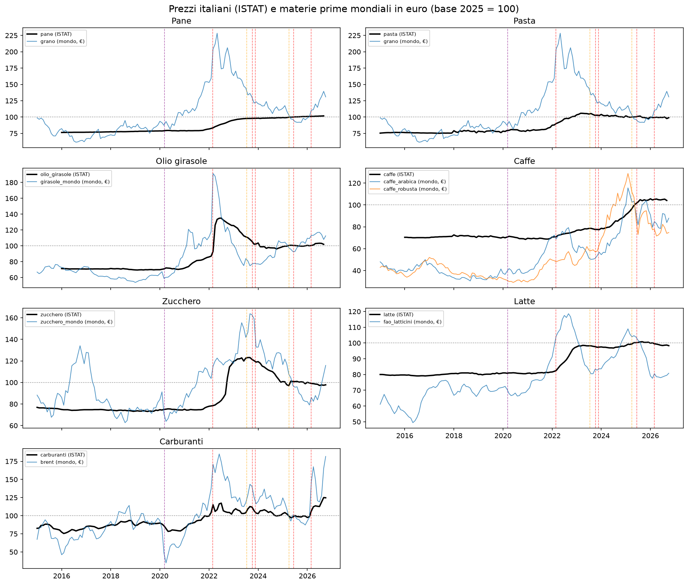
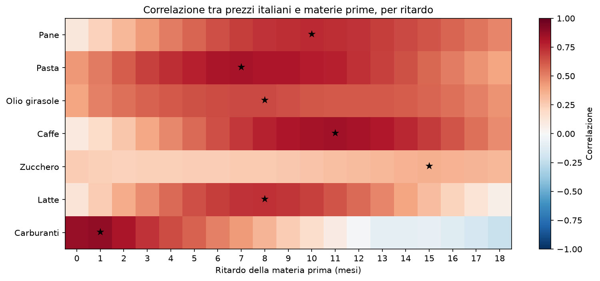
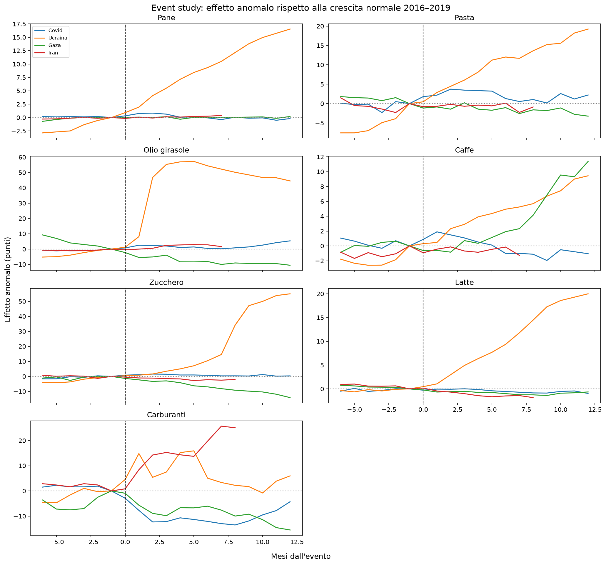

# Il carrello della spesa e le crisi geopolitiche

Come cambiano i prezzi del carrello in Italia durante le crisi geopolitiche (2015–2026).

## Domanda
Come sono cambiati i prezzi del carrello in Italia durante le crisi
geopolitiche dal 2015 a oggi?

## Risultati principali

### 1. L'invasione dell'Ucraina è stata la crisi più forte per il carrello
Dodici mesi dopo l'invasione (febbraio 2022), al netto dell'andamento che i prezzi
avrebbero avuto comunque, gli aumenti sono stati di circa **+20 punti per il latte**,
**+50–55 per lo zucchero**, **+14–17 per il pane** e **tra +9 e +19 per la pasta**.
Nessun'altra crisi analizzata (Covid, Gaza, Mar Rosso, dazi USA) ha avuto effetti
comparabili sui prodotti alimentari.

### 2. Il caso dell'olio di girasole: l'effetto più diretto della guerra
L'Ucraina è tra i principali esportatori mondiali di olio di girasole. Con l'invasione e il
blocco dei porti del Mar Nero, il prezzo mondiale è salito subito e quello italiano
lo ha seguito in 1–2 mesi, arrivando a **circa +57% in cinque mesi**.
- È il prodotto con l'effetto anomalo più forte: **tra +22 e +45 punti** dopo 12 mesi,
  a seconda di come si definisce l'andamento "normale".
- Anche tenendo conto di materia prima, energia e fertilizzanti, resta un **effetto
  aggiuntivo di circa 29 punti** nell'anno dopo l'invasione. Ipotesi: scarsità fisica del
  prodotto importato dall'Ucraina e acquisti di scorte nella primavera 2022.
- Il suo prezzo è legato molto più al rischio geopolitico **dell'Ucraina** (correlazione 0,59)
  che a quello globale (0,23).

### 3. Le crisi pesano attraverso le materie prime e soprattutto l'energia
I prezzi italiani seguono le materie prime mondiali, ma con **ritardi molto diversi**:
circa **1 mese** per i carburanti, **7–11 mesi** per pasta, latte, pane e caffè.
Nei modelli di regressione l'**energia** (gas) è il fattore significativo per 4 prodotti
su 6: nella crisi del 2022 il carrello è stato colpito più dal costo dell'energia che dalle
singole materie prime. I fertilizzanti contano per i prodotti più vicini al campo
(zucchero, olio di girasole, latte); i trasporti non risultano significativi.





### 4. Un alto rischio geopolitico, da solo, non fa salire i prezzi
Il Geopolitical Risk Index ha picchi anche in momenti senza rincari (fine 2015, inizio 2020,
Gaza 2023). Per tutti i prodotti la correlazione con la materia prima è più alta di quella
con il rischio geopolitico globale. **Conta dove colpisce una crisi, non quanto se ne parla**:
il rischio legato ai paesi produttori (Russia, Ucraina) spiega molto meglio i prezzi
di grano e girasole.

### 5. I prezzi salgono veloci e scendono lenti
Dopo il picco del 2022, grano e girasole mondiali sono tornati indietro, mentre pane, pasta
e latte sono rimasti sui livelli raggiunti. Solo i prodotti più vicini alla materia prima
(olio di girasole, zucchero) sono in parte riscesi.

### 6. La guerra in Iran (2026) colpisce l'energia
I carburanti sono saliti di **circa +25–32 punti** sopra il loro andamento normale in
otto mesi, più che con l'Ucraina e nonostante i tagli delle accise. Sui prodotti alimentari
l'effetto non si vede ancora: con ritardi di 7–11 mesi, è un'analisi da aggiornare.



### Non tutto è geopolitica
Il rincaro più forte del caffè (2025) non è legato a nessuna crisi, ma al prezzo mondiale
della Robusta. Il grano saliva già nel 2021, prima della guerra. Il taglio delle accise del
2022 ha attenuato l'aumento dei carburanti.

## Metodo
1. **Pulizia** – unione di 5 fonti in un dataset mensile (gennaio 2015 – ottobre 2026);
   indici ISTAT riportati in base 2025 = 100 con i coefficienti di raccordo ufficiali.
2. **Esplorazione** – grafici dei prezzi, delle variazioni su 12 mesi e del rischio
   geopolitico, con le date delle crisi.
3. **Correlazioni** – calcolate sulle variazioni (non sui livelli, per evitare correlazioni
   spurie), con la ricerca del ritardo tra materie prime e prezzi italiani.
4. **Modello**
   - regressioni con controlli (materia prima, energia, trasporti, fertilizzanti,
     effetto della guerra in Ucraina), con errori standard HAC (Newey-West);
   - event study con effetto anomalo, confrontando due definizioni dell'andamento
     "normale" (tendenza dei 12 mesi precedenti e crescita media 2016–2019).

## Prodotti analizzati
Pane, pasta, olio di girasole, caffè, zucchero, latte, carburanti.

Fattori esterni: prezzi mondiali delle materie prime (grano, olio di girasole, caffè Arabica
e Robusta, zucchero, indice FAO dei latticini), energia (Brent, gas europeo), fertilizzanti
(urea), cambio euro/dollaro e Geopolitical Risk Index.

## Dati
| Fonte | Cosa contiene |
|---|---|
| ISTAT – NIC (Ecoicop 2) | Prezzi al consumo per prodotto, mensili |
| FAO Food Price Index | Prezzi mondiali del cibo |
| Geopolitical Risk Index (Caldara & Iacoviello) | Tensioni geopolitiche, mensili |
| World Bank Pink Sheet | Prezzi delle materie prime |
| BCE | Cambio euro/dollaro |
| eventi.csv | Date delle crisi considerate |

I dati originali sono in `data_market/raw/` e non vengono modificati;
il dataset pulito è `data_market/processed/dataset_mensile.csv`.

### Fonti delle date degli eventi
| Evento | Data | Fonte |
|---|---|---|
| Occupazione russa della Crimea | 2014-02-27 | [Wikipedia](https://it.wikipedia.org/wiki/Annessione_della_Crimea_alla_Russia) |
| Covid-19 dichiarato pandemia dall'OMS | 2020-03-11 | [SkyTG24](https://tg24.sky.it/salute-e-benessere/2026/03/11/covid-pandemia-oms-anniversario) |
| Invasione russa dell'Ucraina | 2022-02-24 | [Wikipedia](https://it.wikipedia.org/wiki/Invasione_russa_dell%27Ucraina_del_2022) |
| Fine dell'accordo sul grano del Mar Nero | 2023-07-17 | [SkyTG24](https://tg24.sky.it/mondo/2023/07/17/accordo-grano-russia-ucraina) |
| Attacco di Hamas e inizio della guerra a Gaza | 2023-10-07 | [Wikipedia](https://it.wikipedia.org/wiki/Attacco_di_Hamas_a_Israele_del_2023) |
| Inizio degli attacchi Houthi nel Mar Rosso | 2023-11-19 | [Aspenia](https://aspeniaonline.it/non-solo-houthi-attorno-al-mar-rosso-una-crisi-multilivello/) |
| Dazi USA del Liberation Day | 2025-04-02 | [Corriere della Sera](https://www.corriere.it/economia/finanza/26_aprile_02/i-dazi-a-un-anno-dal-liberation-day-cosa-e-cambiato-per-l-economia-usa-e-cosa-dicono-i-numeri-044a71f1-ac7d-4a49-b203-6d0f692a6xlk.shtml) |
| Guerra dei 12 giorni tra Israele e Iran | 2025-06-13 | [LaPresse](https://www.lapresse.it/esteri/2025/06/24/iran-la-guerra-dei-12-giorni-dallattacco-di-israele-alla-tregua-annunciata-da-trump/) |
| Attacco di USA e Israele all'Iran | 2026-02-28 | [SkyTG24](https://tg24.sky.it/mondo/2026/02/28/guerra-iran-usa-israele-precedente) |

## Struttura del repository
```
data_market/
  raw/          dati originali scaricati dalle fonti
  processed/    dati puliti
notebooks/
  01_pulizia.ipynb        Fase 2 – pulizia e unione dei dati
  02_esplorazione.ipynb   Fase 3 – grafici esplorativi
  03_correlazioni.ipynb   Fase 4 – correlazioni e ritardi
  04_modello.ipynb        Fase 5 – regressioni ed event study
figure/         grafici usati in questo README
```

## Come riprodurre l'analisi
```
python -m venv .venv
.venv\Scripts\activate        # su Mac/Linux: source .venv/bin/activate
pip install -r requirements.txt
```
Poi eseguire i notebook in ordine, da `01_pulizia.ipynb` a `04_modello.ipynb`.

## Stato del progetto
- [x] Fase 1 – Domanda e dati
- [x] Fase 2 – Pulizia
- [x] Fase 3 – Esplorazione
- [x] Fase 4 – Correlazioni
- [x] Fase 5 – Modello (regressioni con controlli, event study)
- [x] Fase 6 – Conclusioni

## Limiti dell'analisi
**Dati**
- **Grano duro non disponibile**: il Pink Sheet della Banca Mondiale non ha il prezzo
  del grano duro (quello della pasta); si usa il grano tenero US HRW come approssimazione.
- **2015 incompleto**: pane, olio di girasole e caffè sono segmenti ISTAT introdotti dal
  2016; per il 2015 sono disponibili solo pasta, latte, zucchero e carburanti.
- **Ultimo mese provvisorio**: ottobre 2026 è una stima ISTAT; pane, olio di girasole
  e caffè non sono ancora disponibili per quel mese.
- **Iran non coperto dal Geopolitical Risk Index**: l'indice per paese copre 44 paesi
  ma non l'Iran; la crisi del 2026 è misurata indirettamente tramite gli indici di
  Israele, Arabia Saudita e Stati Uniti.
- **Indice dell'Arabia Saudita poco reattivo**: resta basso anche durante la crisi di
  Hormuz del 2026, quindi rappresenta male il rischio nel Golfo Persico.
- **Punto di vista occidentale del GPR**: l'indice è costruito su giornali americani e
  britannici, quindi misura il rischio geopolitico come viene raccontato in Occidente.

**Metodo**
- **Eventi sovrapposti**: la guerra a Gaza (ottobre 2023) e gli attacchi nel Mar Rosso
  (novembre 2023) sono troppo vicini per separarne gli effetti con dati mensili; anche le
  finestre di altri eventi (dazi USA, guerra dei 12 giorni) contengono la guerra in Iran.
- **Periodi "normali" non normali**: i rincari post-Covid erano ancora in corso all'inizio
  della guerra in Ucraina, quindi la stima dell'andamento atteso è incerta. L'effetto della
  guerra è stato calcolato con due definizioni del "normale": la tendenza dei 12 mesi
  precedenti l'invasione (che include i rincari post-Covid) e la crescita media 2016–2019,
  un periodo precedente al Covid. Per pasta e olio di girasole i due metodi danno risultati
  diversi, quindi l'effetto è riportato come intervallo; per i carburanti il risultato è
  troppo incerto per essere riportato.
- **Variazioni su 12 mesi sovrapposte**: rendono le correlazioni un po' più alte e gli errori
  dei modelli legati tra loro (corretti con errori standard HAC).
- **Ritardi scelti come i migliori tra molti possibili**: le correlazioni corrispondenti sono
  un po' ottimiste e i ritardi vanno letti come "circa".
- **L'effetto aggiuntivo della guerra è un "contenitore"**: misura tutto ciò che materie prime
  ed energia non spiegano nell'anno dopo l'invasione, senza identificarne la causa precisa.

## Sviluppi futuri
- Difference-in-differences sui carburanti Italia vs USA (guerra in Iran 2026), con le misure
  fiscali sulle accise come controllo (`misure_fiscali.csv`, da completare per il 2026)
- Previsione dei prezzi con machine learning
- Aggiornare l'analisi dell'Iran 2026 sugli alimentari quando saranno disponibili più mesi

## Autore
Emanuele Mercadante – [LinkedIn](https://www.linkedin.com/in/emanuele-mercadante-274180333/)