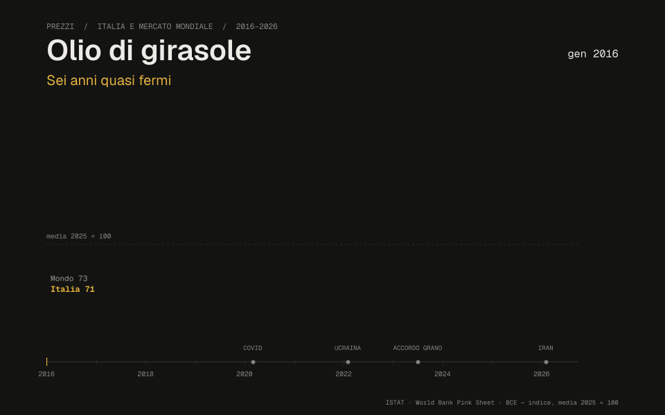
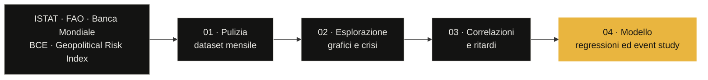
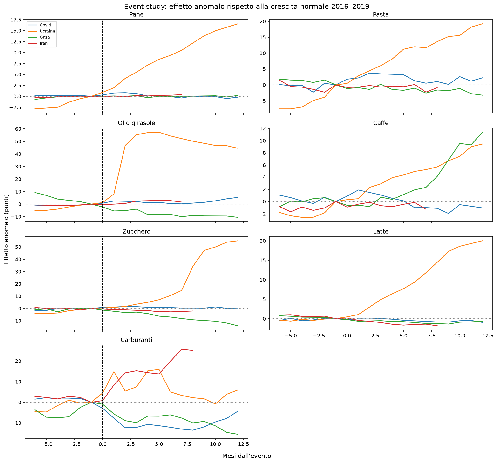
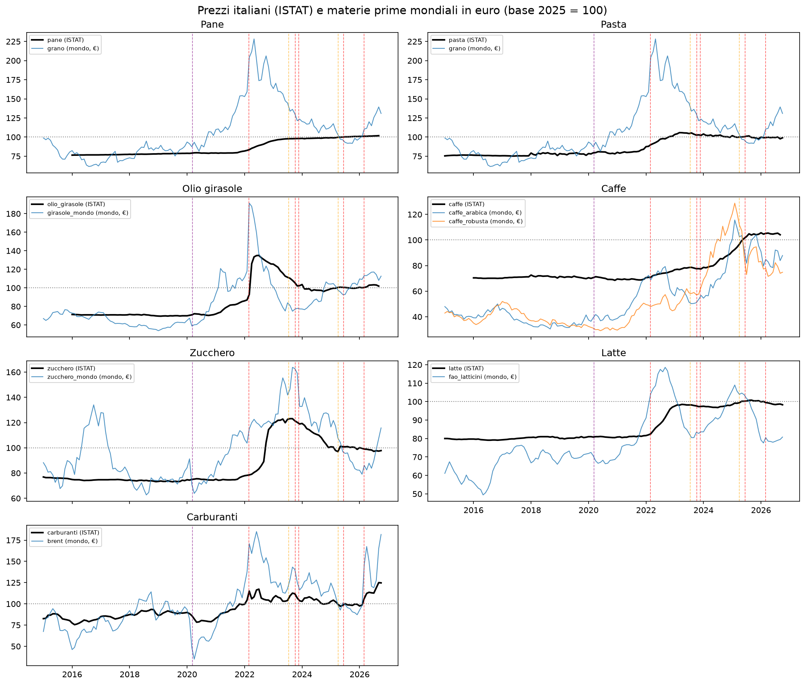

<p align="center">
  
</p>

<h1 align="center">Il carrello della spesa e le crisi geopolitiche</h1>

<p align="center">
  <b>Una crisi lontana fa salire i prezzi al supermercato? Non sempre: dipende da cosa colpisce.</b><br>
  Dieci anni di prezzi di sette prodotti del carrello in Italia, messi a confronto con otto crisi geopolitiche.
</p>

<p align="center">
  
  
  
  
</p>

<p align="center">
  <a href="#risultati">Risultati</a> ·
  <a href="notebooks/">Notebook</a> ·
  <a href="data_market/processed/dataset_mensile.csv">Dataset pulito</a> ·
  <a href="#limiti-dellanalisi">Limiti</a> ·
  <a href="#come-riprodurre-lanalisi">Riprodurre l'analisi</a>
</p>

---

## In 60 secondi

<table>
  <tr>
    <td align="center" width="33%">
      <h3>+57%</h3>
      <sub>olio di girasole in Italia<br>nei cinque mesi dopo l'invasione dell'Ucraina</sub>
    </td>
    <td align="center" width="33%">
      <h3>4 prodotti su 6</h3>
      <sub>in cui il costo dell'energia è un fattore<br>significativo dell'aumento dei prezzi</sub>
    </td>
    <td align="center" width="33%">
      <h3>1 → 11 mesi</h3>
      <sub>il tempo che una materia prima impiega<br>ad arrivare allo scaffale (carburanti → caffè)</sub>
    </td>
  </tr>
</table>

- **L'invasione dell'Ucraina è stata la crisi più pesante per il carrello**: dodici mesi dopo, al netto
  dell'andamento normale, latte circa +20 punti, zucchero +50–55, pane +14–17.
- **Le crisi arrivano allo scaffale soprattutto attraverso l'energia**, non solo attraverso le materie prime.
- **Un alto rischio geopolitico, da solo, non fa salire i prezzi**: conta quali materie prime e rotte una crisi colpisce.

## La domanda

Come sono cambiati i prezzi del carrello in Italia durante le crisi geopolitiche, dal 2015 a oggi?

Più in dettaglio: attraverso quali canali una crisi lontana arriva ai prezzi al consumo (materie prime,
energia, fertilizzanti, trasporti) e con quale ritardo. L'analisi confronta i prezzi italiani di sette prodotti
(pane, pasta, olio di girasole, caffè, zucchero, latte, carburanti) con le materie prime mondiali, il costo
dell'energia, il cambio euro/dollaro e un indice di rischio geopolitico.

## Struttura dell'analisi

Quattro notebook trasformano cinque fonti ufficiali in un dataset mensile unico
(gennaio 2015 – ottobre 2026, **142 mesi × 33 serie**) e lo analizzano.



| Notebook | Contenuto | Output |
|---|---|---|
| [`01_pulizia`](notebooks/01_pulizia.ipynb) | unione delle 5 fonti, indici ISTAT portati in base 2025 | `dataset_mensile.csv` |
| [`02_esplorazione`](notebooks/02_esplorazione.ipynb) | prezzi, variazioni su 12 mesi e rischio geopolitico nel tempo | grafici con le date delle crisi |
| [`03_correlazioni`](notebooks/03_correlazioni.ipynb) | legami tra prezzi e materie prime, e relativi ritardi | heatmap dei ritardi |
| [`04_modello`](notebooks/04_modello.ipynb) | regressioni con controlli ed event study | stime dell'effetto delle crisi |

## Risultati

### Quanto ha pesato la crisi ucraina?

| Prodotto | Effetto dopo 12 mesi (punti) |
|---|---|
| Zucchero | **+50–55** |
| Olio di girasole | +22–45 |
| Latte | circa +20 |
| Pane | +14–17 |
| Pasta | +9–19 |

Effetto stimato dodici mesi dopo l'invasione, sottraendo l'aumento che ci sarebbe stato comunque. Gli intervalli
dipendono da come si definisce l'andamento "normale" (vedi [Limiti](#limiti-dellanalisi)). Le altre crisi
analizzate (Covid, Gaza, Mar Rosso, dazi USA) non hanno avuto effetti paragonabili sui prodotti alimentari.

<p align="center">
  
</p>
<p align="center"><sub>Scostamento dei prezzi dall'andamento che avrebbero avuto crescendo come nel 2016–2019 · mese 0 = inizio della crisi</sub></p>

### Olio di girasole: l'effetto più diretto della guerra

L'Ucraina è tra i principali esportatori mondiali di olio di girasole. Con l'invasione e il blocco dei porti del
Mar Nero il prezzo mondiale è salito subito; quello italiano lo ha seguito in uno o due mesi, con un aumento di
circa il 57% in cinque mesi.

<table>
  <tr>
    <td align="center" width="50%">
      <h3>circa 29 punti</h3>
      <sub>effetto aggiuntivo nell'anno dopo l'invasione, oltre quanto spiegano<br>materia prima, energia e fertilizzanti</sub>
    </td>
    <td align="center" width="50%">
      <h3>0,59 vs 0,23</h3>
      <sub>correlazione con il rischio geopolitico dell'Ucraina<br>e con quello globale</sub>
    </td>
  </tr>
</table>

Possibili spiegazioni dell'effetto aggiuntivo: scarsità del prodotto importato dall'Ucraina e acquisti di scorte
nella primavera 2022.

### Il gas ha pesato più del grano

<p align="center">
  
</p>
<p align="center"><sub>Prezzi italiani (linea nera) e materie prime mondiali in euro · base 2025 = 100</sub></p>

Nei modelli di regressione il prezzo del gas europeo è significativo per **4 prodotti su 6** (pane, pasta,
zucchero, latte). Per la pasta, tenendo fermo il gas, l'effetto stimato del grano scende a meno della metà.
I fertilizzanti contano per i prodotti più vicini alla produzione agricola (zucchero, olio di girasole, latte);
i trasporti non risultano significativi.

### Dalla materia prima allo scaffale: fino a un anno

<table>
  <tr>
    <td width="62%">
      
    </td>
    <td width="38%">
      <table>
        <tr><th>Prodotto</th><th>Ritardo</th><th>Corr.</th></tr>
        <tr><td>Carburanti</td><td>~1 mese</td><td><b>0,89</b></td></tr>
        <tr><td>Pasta</td><td>~7 mesi</td><td>0,82</td></tr>
        <tr><td>Latte</td><td>~8 mesi</td><td>0,73</td></tr>
        <tr><td>Pane</td><td>~10 mesi</td><td>0,75</td></tr>
        <tr><td>Caffè</td><td>~11 mesi</td><td>0,84</td></tr>
      </table>
    </td>
  </tr>
</table>

I carburanti si adeguano quasi subito; il caffè impiega quasi un anno, anche perché i torrefattori acquistano il
caffè verde con largo anticipo. Lo zucchero italiano segue poco il mercato mondiale.

### Il rischio geopolitico, da solo, non basta

Il Geopolitical Risk Index registra picchi anche in periodi senza rincari (fine 2015, inizio 2020, Gaza 2023).
Per tutti i prodotti la correlazione con la materia prima è più alta di quella con il rischio globale, anche
concedendo a entrambi lo stesso ritardo. Il rischio dei paesi produttori, invece, funziona:

| Prodotto | Rischio globale | Rischio del paese produttore |
|---|---|---|
| Pane | 0,37 | **0,70** (Russia) |
| Pasta | 0,15 | **0,60** (Russia) |
| Olio di girasole | 0,23 | **0,59** (Ucraina) |
| Carburanti | 0,28 | **0,42** (Russia) |

### Aumenti rapidi, discese lente

Dopo il picco del 2022 grano e girasole mondiali sono tornati indietro; pane, pasta e latte sono rimasti sui
livelli raggiunti. Solo i prodotti più vicini alla materia prima (olio di girasole, zucchero) sono in parte scesi.

### La guerra in Iran (2026): per ora uno shock energetico

In otto mesi i carburanti sono saliti di **circa 25–32 punti** oltre il loro andamento normale, più che con
l'Ucraina e nonostante i tagli delle accise. Sui prodotti alimentari l'effetto non è ancora visibile.

> [!TIP]
> Con ritardi di 7–11 mesi tra materie prime e scaffale, l'effetto della guerra in Iran sugli alimentari
> potrebbe comparire tra fine 2026 e inizio 2027: è il primo aggiornamento da fare.

### Non tutto è geopolitica

Il rincaro più forte del caffè (2025) non è legato a una crisi, ma al prezzo mondiale della Robusta. Il grano era
in aumento già nel 2021, prima della guerra. Il taglio delle accise del 22 marzo 2022 si riconosce nei dati:
i carburanti scendono il mese successivo al primo picco.

## Metodo

| Tecnica | Perché |
|---|---|
| **Correlazioni sulle variazioni**, non sui livelli | latte italiano e rischio geopolitico degli USA: 0,53 sui livelli, −0,05 sulle variazioni; sui livelli emergono legami solo apparenti |
| **Regressioni con controlli** | separano materia prima (ritardo lungo e di un mese), energia, trasporti, fertilizzanti e l'anno dopo l'invasione |
| **Event study** | ogni crisi diventa il "mese 0" e si misura lo scostamento dall'andamento atteso |

<details>
<summary><b>Dettagli tecnici</b></summary>
<br>

- Indici ISTAT NIC (Ecoicop 2) portati in base 2025 = 100 con i coefficienti di raccordo ufficiali
  (2015 da base 2010, 2016–2025 da base 2015).
- Materie prime convertite da dollari a euro con il cambio medio mensile BCE.
- Variazioni percentuali su 12 mesi, per eliminare tendenza e stagionalità.
- Ritardi scelti come quelli con la correlazione più alta tra 0 e 18 mesi.
- Regressioni OLS con errori standard HAC (Newey-West), 12 ritardi, per tenere conto della sovrapposizione
  tra variazioni su 12 mesi.
- Event study con due definizioni dell'andamento normale: tendenza dei 12 mesi precedenti l'evento e
  crescita media 2016–2019.

</details>

## Come riprodurre l'analisi

```bash
git clone https://github.com/emamercadante03-sketch/carrello-crisi-geopolitiche.git
cd carrello-crisi-geopolitiche
python -m venv .venv
.venv\Scripts\activate          # su Mac/Linux: source .venv/bin/activate
pip install -r requirements.txt
```

Poi eseguire i notebook della cartella [`notebooks/`](notebooks/) in ordine, da `01_pulizia` a `04_modello`.

## Limiti dell'analisi

> [!NOTE]
> Per pasta e olio di girasole l'effetto della guerra è riportato come intervallo, perché dipende da come si stima
> l'andamento che i prezzi avrebbero avuto senza la crisi. Per i carburanti, nel caso dell'Ucraina, il risultato è
> troppo incerto per essere riportato.

<details>
<summary><b>Limiti dei dati</b></summary>
<br>

- **Grano duro non disponibile**: il Pink Sheet della Banca Mondiale non riporta il grano duro (quello della
  pasta); si usa il grano tenero US HRW come approssimazione.
- **2015 incompleto**: pane, olio di girasole e caffè sono segmenti ISTAT introdotti dal 2016.
- **Ultimo mese provvisorio**: ottobre 2026 è una stima ISTAT; pane, olio di girasole e caffè non sono ancora
  disponibili per quel mese.
- **Iran non coperto dal Geopolitical Risk Index**; l'indice dell'Arabia Saudita resta basso anche durante la
  crisi di Hormuz, quindi il rischio nel Golfo è misurato solo indirettamente.
- **Punto di vista occidentale del GPR**: l'indice si basa su giornali americani e britannici.

</details>

<details>
<summary><b>Limiti del metodo</b></summary>
<br>

- **Eventi sovrapposti**: Gaza e Mar Rosso sono troppo vicini per separarne gli effetti; le finestre dei dazi USA
  e della guerra dei 12 giorni comprendono la guerra in Iran.
- **Periodi "normali" non normali**: l'effetto della guerra è calcolato con due definizioni del "normale", la
  tendenza dei 12 mesi precedenti l'invasione (che include i rincari post-Covid) e la crescita media 2016–2019,
  precedente al Covid. Per pasta e olio di girasole i due metodi danno risultati diversi, da cui gli intervalli.
- **Variazioni su 12 mesi sovrapposte**: tendono ad aumentare le correlazioni (nei modelli si usano errori
  standard HAC).
- **Ritardi scelti come i migliori tra 19**: le correlazioni corrispondenti sono leggermente ottimistiche, e i
  ritardi vanno letti come valori indicativi.
- **L'effetto aggiuntivo della guerra è una misura residua**: comprende tutto ciò che materie prime ed energia non
  spiegano nell'anno successivo all'invasione, senza identificarne la causa.

</details>

### Cosa ho imparato strada facendo

<table>
  <tr>
    <td valign="top" width="33%">
      <b>I dati non arrivano mai pronti</b><br><br>
      <sub>Il CSV dell'ISTAT codificava gli apostrofi in un modo che impediva la lettura, e i dati erano in tre basi
      diverse (2010, 2015, 2025), da ricollegare con i coefficienti ufficiali.</sub>
    </td>
    <td valign="top" width="33%">
      <b>I dati possono segnalare ciò che manca</b><br><br>
      <sub>Un picco del rischio geopolitico a metà 2025 non corrispondeva a nessuna crisi dell'elenco: era la guerra
      dei 12 giorni tra Israele e Iran, poi aggiunta all'analisi.</sub>
    </td>
    <td valign="top" width="33%">
      <b>Ogni metodo va verificato sui casi limite</b><br><br>
      <sub>Prolungando la tendenza precedente, Gaza sembrava aver ridotto lo zucchero di 56 punti: la tendenza
      "normale" era quella della crisi ucraina. Da qui il confronto con il 2016–2019.</sub>
    </td>
  </tr>
</table>

## Sviluppi futuri

- [ ] Difference-in-differences sui carburanti Italia–USA per la guerra in Iran, con le accise come controllo
  (`misure_fiscali.csv`, da completare per il 2026)
- [ ] Previsione dei prezzi con machine learning
- [ ] Aggiornamento dell'analisi dell'Iran 2026 sugli alimentari quando saranno disponibili più mesi

## Fonti

| Fonte | Contenuto |
|---|---|
| ISTAT – NIC (Ecoicop 2) | prezzi al consumo per prodotto, mensili |
| FAO Food Price Index | prezzi mondiali del cibo |
| Geopolitical Risk Index (Caldara & Iacoviello) | tensioni geopolitiche, mensili |
| World Bank Pink Sheet | prezzi delle materie prime |
| BCE | cambio euro/dollaro |

I dati originali sono in `data_market/raw/` e non vengono modificati; il dataset pulito è
[`data_market/processed/dataset_mensile.csv`](data_market/processed/dataset_mensile.csv).

<details>
<summary><b>Fonti delle date delle crisi</b></summary>
<br>

| Evento | Data | Fonte |
|---|---|---|
| Occupazione russa della Crimea | 2014-02-27 | [Wikipedia](https://it.wikipedia.org/wiki/Annessione_della_Crimea_alla_Russia) |
| Covid-19 dichiarato pandemia dall'OMS | 2020-03-11 | [SkyTG24](https://tg24.sky.it/salute-e-benessere/2026/03/11/covid-pandemia-oms-anniversario) |
| Invasione russa dell'Ucraina | 2022-02-24 | [Wikipedia](https://it.wikipedia.org/wiki/Invasione_russa_dell%27Ucraina_del_2022) |
| Fine dell'accordo sul grano del Mar Nero | 2023-07-17 | [SkyTG24](https://tg24.sky.it/mondo/2023/07/17/accordo-grano-russia-ucraina) |
| Attacco di Hamas e inizio della guerra a Gaza | 2023-10-07 | [Wikipedia](https://it.wikipedia.org/wiki/Attacco_di_Hamas_a_Israele_del_2023) |
| Inizio degli attacchi Houthi nel Mar Rosso | 2023-11-19 | [Aspenia](https://aspeniaonline.it/non-solo-houthi-attorno-al-mar-rosso-una-crisi-multilivello/) |
| Dazi USA del Liberation Day | 2025-04-02 | [Corriere della Sera](https://www.corriere.it/economia/finanza/26_aprile_02/i-dazi-a-un-anno-dal-liberation-day-cosa-e-cambiato-per-l-economia-usa-e-cosa-dicono-i-numeri-044a71f1-ac7d-4a49-b203-6d0f692a6xlk.shtml) |
| Guerra dei 12 giorni tra Israele e Iran | 2025-06-13 | [LaPresse](https://www.lapresse.it/esteri/2025/06/24/iran-la-guerra-dei-12-giorni-dallattacco-di-israele-alla-tregua-annunciata-da-trump/) |
| Attacco di USA e Israele all'Iran | 2026-02-28 | [SkyTG24](https://tg24.sky.it/mondo/2026/02/28/guerra-iran-usa-israele-precedente) |

</details>

---

<p align="center">
  <b>Emanuele Mercadante</b><br>
  <a href="https://www.linkedin.com/in/emanuele-mercadante-274180333/">LinkedIn</a> ·
  <a href="https://github.com/emamercadante03-sketch">GitHub</a> ·
  <a href="LICENSE">Licenza MIT</a>
</p>
