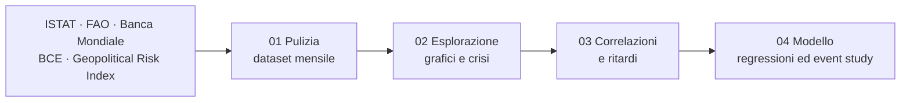

# Il carrello della spesa e le crisi geopolitiche

**Una guerra fa salire i prezzi al supermercato? Solo se colpisce le cose giuste.**
Undici anni di prezzi ISTAT, otto crisi, sette prodotti: dopo l'invasione dell'Ucraina
l'olio di girasole è salito di **circa il 57% in cinque mesi**, mentre crisi molto più
raccontate dai media non hanno mosso il carrello.


*Ogni linea mostra di quanto il prezzo si è discostato, mese per mese, dall'andamento che avrebbe
avuto crescendo come nel 2016–2019 (mese 0 = inizio della crisi). Solo l'Ucraina (alimentari)
e l'Iran (carburanti) producono effetti forti.*

[I risultati](#cosa-è-successo-al-carrello) · [I notebook](notebooks/) · [Il dataset pulito](data_market/processed/dataset_mensile.csv) · [Limiti](#dove-non-fidarsi-di-questi-numeri)

---

## In 60 secondi

- **L'Ucraina è stata la crisi più forte per il carrello**: dodici mesi dopo l'invasione,
  al netto dell'andamento normale, latte **+20 punti**, zucchero **+50–55**, pane **+14–17**.
- **Le crisi arrivano al supermercato soprattutto attraverso l'energia**, con ritardi da
  **1 mese** (carburanti) a **quasi un anno** (caffè).
- **Conta dove colpisce una crisi, non quanto se ne parla**: un alto rischio geopolitico,
  da solo, non fa salire i prezzi.

## La domanda

Come sono cambiati i prezzi del carrello in Italia durante le crisi geopolitiche,
dal 2015 a oggi?

Dietro c'è una domanda più utile: **attraverso quali canali** una guerra lontana arriva
allo scontrino? Le materie prime, l'energia, i fertilizzanti, i trasporti? E con quanto
ritardo? Per rispondere ho confrontato i prezzi italiani di **sette prodotti** (pane, pasta,
olio di girasole, caffè, zucchero, latte, carburanti) con le materie prime mondiali, il costo
dell'energia, il cambio euro/dollaro e un indice di rischio geopolitico.

## Cosa ho costruito

Un'analisi in quattro notebook, da cinque fonti ufficiali a un dataset mensile unico
(gennaio 2015 – ottobre 2026, 142 mesi × 33 serie).



| Notebook | Cosa fa | Output |
|---|---|---|
| [01_pulizia](notebooks/01_pulizia.ipynb) | unisce le 5 fonti e porta gli indici ISTAT in base 2025 | `dataset_mensile.csv` |
| [02_esplorazione](notebooks/02_esplorazione.ipynb) | prezzi, variazioni su 12 mesi e rischio geopolitico nel tempo | grafici con le date delle crisi |
| [03_correlazioni](notebooks/03_correlazioni.ipynb) | legami tra prezzi e materie prime, e con quale ritardo | heatmap dei ritardi |
| [04_modello](notebooks/04_modello.ipynb) | regressioni con controlli ed event study | stime dell'effetto delle crisi |

## Cosa è successo al carrello

### L'invasione dell'Ucraina si stacca da tutte le altre crisi

Dodici mesi dopo l'invasione, sottraendo l'aumento che ci sarebbe stato comunque:

| Prodotto | Effetto della crisi dopo 12 mesi (punti) |
|---|---|
| Zucchero | **+50–55** |
| Olio di girasole | +22–45 |
| Latte | circa +20 |
| Pane | +14–17 |
| Pasta | +9–19 |

Lo zucchero ha avuto l'effetto più forte. Gli intervalli dipendono da come si definisce
l'andamento "normale" (spiegato nei [limiti](#dove-non-fidarsi-di-questi-numeri)).
Nessun'altra crisi analizzata (Covid, Gaza, Mar Rosso, dazi USA) ha avuto effetti comparabili
sui prodotti alimentari.

### L'olio di girasole: l'effetto più diretto della guerra

L'Ucraina è tra i principali esportatori mondiali di olio di girasole. Con l'invasione e il
blocco dei porti del Mar Nero il prezzo mondiale è salito subito, e quello italiano lo ha
seguito in 1–2 mesi: **circa +57% in cinque mesi**.

- Anche tenendo conto di materia prima, energia e fertilizzanti, resta un **effetto aggiuntivo
  di circa 29 punti** nell'anno dopo l'invasione. Ipotesi: scarsità fisica del prodotto
  importato dall'Ucraina e acquisti di scorte nella primavera 2022.
- Il suo prezzo è legato al rischio geopolitico **dell'Ucraina** (correlazione **0,59**)
  molto più che a quello globale (0,23).

### Il gas ha pesato più del grano


*I prezzi italiani (linea nera) seguono le materie prime mondiali in euro, ma attenuati e in ritardo.*

Nei modelli di regressione l'**energia** (gas europeo) è significativa per **4 prodotti su 6**:
pane, pasta, zucchero e latte. Per la pasta, tenendo fermo il gas, l'effetto del grano scende
a meno della metà. I fertilizzanti contano per i prodotti più vicini al campo (zucchero, olio di girasole,
latte); i trasporti non risultano significativi.

### Dal grano al supermercato: fino a un anno di viaggio


*Ogni riga è un prodotto, ogni colonna un ritardo in mesi; la ★ indica il ritardo con il legame più forte.*

| Prodotto | Ritardo dalla materia prima | Correlazione |
|---|---|---|
| Carburanti | circa 1 mese | **0,89** |
| Pasta | circa 7 mesi | 0,82 |
| Latte | circa 8 mesi | 0,73 |
| Pane | circa 10 mesi | 0,75 |
| Caffè | circa 11 mesi | 0,84 |

I carburanti reagiscono quasi subito; il caffè impiega quasi un anno, perché i torrefattori
comprano il caffè verde con largo anticipo. Lo zucchero italiano segue poco il mercato mondiale.

### Il rischio geopolitico, da solo, non basta

Il Geopolitical Risk Index ha picchi anche in momenti senza rincari (fine 2015, inizio 2020,
Gaza 2023). Per **tutti** i prodotti la correlazione con la materia prima è più alta di quella
con il rischio globale, anche dando a entrambi lo stesso vantaggio del ritardo.
Il rischio dei paesi produttori, invece, funziona: per pane e pasta la correlazione con il
rischio della Russia è **0,70** e **0,60**, contro 0,37 e 0,15 per il rischio globale.

### I prezzi salgono veloci e scendono lenti

Dopo il picco del 2022, grano e girasole mondiali sono tornati indietro; pane, pasta e latte
no. Solo i prodotti più vicini alla materia prima (olio di girasole, zucchero) sono in parte
riscesi.

### Iran 2026: un nuovo shock, per ora solo energetico

In otto mesi i carburanti sono saliti di **circa +25–32 punti** sopra il loro andamento normale,
più che con l'Ucraina e nonostante i tagli delle accise. Sugli alimentari l'effetto non si vede
ancora: con ritardi di 7–11 mesi, è un'analisi da aggiornare.

### Non tutto è geopolitica

Il rincaro più forte del caffè (2025) non è legato a nessuna crisi, ma al prezzo mondiale della
Robusta. Il grano saliva già nel 2021, prima della guerra. E il taglio delle accise del 22 marzo
2022 si vede a occhio nudo: i carburanti crollano il mese dopo il primo picco.

## Come funziona

- **Correlazioni sulle variazioni, non sui livelli.** Latte italiano e rischio geopolitico degli
  USA hanno correlazione 0,53 sui livelli e −0,05 sulle variazioni: sui livelli si trovano
  legami falsi, dovuti solo a una tendenza comune.
- **Regressioni con controlli**: ogni prodotto è spiegato da materia prima (con ritardo lungo e
  di 1 mese), energia, trasporti, fertilizzanti e una variabile per l'anno dopo l'invasione.
- **Event study**: ogni crisi diventa il "mese 0" e si misura quanto il prezzo si discosta
  dall'andamento atteso.

<details>
<summary>Dettagli tecnici</summary>

- Indici ISTAT NIC (Ecoicop 2) portati in **base 2025 = 100** con i coefficienti di raccordo
  ufficiali (2015 da base 2010, 2016–2025 da base 2015).
- Materie prime convertite da dollari a euro con il cambio medio mensile BCE.
- Variazioni percentuali su 12 mesi, per eliminare tendenza e stagionalità.
- Ritardi scelti come quelli con la correlazione più alta tra 0 e 18 mesi.
- Regressioni OLS con errori standard **HAC (Newey-West)**, 12 ritardi, per tenere conto della
  sovrapposizione tra variazioni su 12 mesi.
- Event study con due definizioni dell'andamento normale: tendenza dei 12 mesi precedenti
  l'evento e crescita media 2016–2019.

</details>

## Provalo tu

```
git clone https://github.com/emamercadante03-sketch/carrello-crisi-geopolitiche.git
cd carrello-crisi-geopolitiche
python -m venv .venv
.venv\Scripts\activate          # su Mac/Linux: source .venv/bin/activate
pip install -r requirements.txt
```

Poi apri i notebook nella cartella `notebooks/` ed eseguili in ordine, da `01_pulizia` a `04_modello`.

## Dove non fidarsi di questi numeri

> [!IMPORTANT]
> Per pasta e olio di girasole l'effetto della guerra è un **intervallo**, non un numero:
> dipende da come si stima cosa sarebbe successo senza la crisi. Per i carburanti con
> l'Ucraina il risultato è troppo incerto per essere riportato.

**Dati**
- **Grano duro non disponibile**: il Pink Sheet della Banca Mondiale non ha il prezzo del grano
  duro (quello della pasta); si usa il grano tenero US HRW come approssimazione.
- **2015 incompleto**: pane, olio di girasole e caffè sono segmenti ISTAT introdotti dal 2016.
- **Ultimo mese provvisorio**: ottobre 2026 è una stima ISTAT; pane, olio di girasole e caffè
  non sono ancora disponibili per quel mese.
- **Iran non coperto dal Geopolitical Risk Index**, e l'indice dell'Arabia Saudita resta basso
  anche durante la crisi di Hormuz: il rischio nel Golfo è misurato solo indirettamente.
- **Punto di vista occidentale del GPR**: l'indice è costruito su giornali americani e britannici.

**Metodo**
- **Eventi sovrapposti**: Gaza e Mar Rosso sono troppo vicini per separarne gli effetti; le
  finestre dei dazi USA e della guerra dei 12 giorni contengono la guerra in Iran.
- **Periodi "normali" non normali**: l'effetto della guerra è calcolato con due definizioni
  del "normale", la tendenza dei 12 mesi precedenti l'invasione (che include i rincari
  post-Covid) e la crescita media 2016–2019, precedente al Covid. Per pasta e olio di girasole
  i due metodi danno risultati diversi, da qui gli intervalli.
- **Variazioni su 12 mesi sovrapposte**: rendono le correlazioni un po' più alte (corretto nei
  modelli con errori standard HAC).
- **Ritardi scelti come i migliori tra 19**: le correlazioni corrispondenti sono un po'
  ottimiste, e i ritardi vanno letti come "circa".
- **L'effetto aggiuntivo della guerra è un "contenitore"**: misura tutto ciò che materie prime
  ed energia non spiegano nell'anno dopo l'invasione, senza identificarne la causa.

### Cosa ho imparato strada facendo

- **I dati non arrivano mai pronti.** Il CSV dell'ISTAT "proteggeva" gli apostrofi in un modo
  che rompeva la lettura, e i dati arrivavano in tre basi diverse (2010, 2015, 2025) da
  ricollegare con i coefficienti ufficiali.
- **I dati mi hanno segnalato un evento che mancava.** Un picco del rischio geopolitico a metà
  2025 non corrispondeva a nessuna crisi del mio elenco: era la guerra dei 12 giorni tra Israele
  e Iran, che ho poi aggiunto.
- **Un metodo può dare risultati assurdi.** Prolungando la tendenza precedente, Gaza sembrava
  aver fatto crollare lo zucchero di 56 punti: in realtà la tendenza "normale" era quella della
  crisi ucraina. Da qui il confronto con un periodo stabile (2016–2019).

## Prossimi passi

- Difference-in-differences sui carburanti Italia vs USA per la guerra in Iran, con le accise
  come controllo (`misure_fiscali.csv`, da completare per il 2026)
- Previsione dei prezzi con machine learning
- Aggiornare l'analisi dell'Iran 2026 sugli alimentari quando saranno disponibili più mesi

## Fonti e contatti

| Fonte | Cosa contiene |
|---|---|
| ISTAT – NIC (Ecoicop 2) | Prezzi al consumo per prodotto, mensili |
| FAO Food Price Index | Prezzi mondiali del cibo |
| Geopolitical Risk Index (Caldara & Iacoviello) | Tensioni geopolitiche, mensili |
| World Bank Pink Sheet | Prezzi delle materie prime |
| BCE | Cambio euro/dollaro |

I dati originali sono in `data_market/raw/` e non vengono modificati; il dataset pulito è
[`data_market/processed/dataset_mensile.csv`](data_market/processed/dataset_mensile.csv).

<details>
<summary>Fonti delle date delle crisi</summary>

| Evento | Data | Fonte |
|---|---|---|
| Occupazione russa della Crimea | 2014-02-27 | [Wikipedia](https://it.wikipedia.org/wiki/Annessione_della_Crimea_alla_Russia) |
| Covid-19 dichiarato pandemia dall'OMS | 2020-03-11 | [SkyTG24](https://tg24.sky.it/salute-e-benessere/2026/03/11/covid-pandemia-oms-anniversario) |
| Invasione russa dell'Ucraina | 2022-02-24 | [Wikipedia](https://it.wikipedia.org/wiki/Invasione_russa_dell%27Ucraina_del_2022) |
| Fine dell'accordo sul grano del Mar Nero | 2023-07-17 | [SkyTG24](https://tg24.sky.it/mondo/2023/07/17/accordo-grano-russia-ucraina) |
| Attacco di Hamas e inizio della guerra a Gaza | 2023-10-07 | [Wikipedia](https://it.wikipedia.org/wiki/Attacco_di_Hamas_a_Israele_del_2023) |
| Inizio degli attacchi Houthi nel Mar Rosso | 2023-11-19 | [Aspenia](https://aspeniaonline.it/non-solo-houthi-attorno-al-mar-rosso-una-crisi-multilivello/) |
| Dazi USA del Liberation Day | 2025-04-02 | [Corriere della Sera](https://www.corriere.it/economia/finanza/26_aprile_02/i-dazi-a-un-anno-dal-liberation-day-cosa-e-cambiato-per-l-economia-usa-e-cosa-dicono-i-numeri-044a71f1-ac7d-4a49-b203-6d0f692a6xlk.shtml) |
| Guerra dei 12 giorni tra Israele e Iran | 2025-06-13 | [LaPresse](https://www.lapresse.it/esteri/2025/06/24/iran-la-guerra-dei-12-giorni-dallattacco-di-israele-alla-tregua-annunciata-da-trump/) |
| Attacco di USA e Israele all'Iran | 2026-02-28 | [SkyTG24](https://tg24.sky.it/mondo/2026/02/28/guerra-iran-usa-israele-precedente) |

</details>

**Autore:** Emanuele Mercadante – [LinkedIn](https://www.linkedin.com/in/emanuele-mercadante-274180333/) · [I notebook del progetto](notebooks/)
